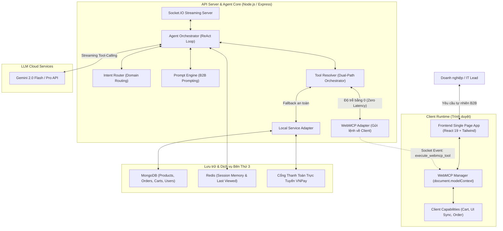

# 🏢 PROCUREPRIME: AUTONOMOUS B2B PROCUREMENT & SMART QUOTATION AGENT FOR ENTERPRISES
> **Đội thi (Team):** **AgentX Prime**  
> **Sản phẩm (Product):** **ProcurePrime**  
> **Cuộc thi:** K-Tech College 2026 — AI for Business Innovation Hackathon  
> **Chủ đề chính thức:** *Solve Real Business Problems with AI*  
> **Lĩnh vực đăng ký:** **Operations & Productivity** / **Supply Chain & Logistics**  
> **Slogan / Tagline:** *"Empowering Enterprise Purchasing with Autonomous AI & Zero-Latency WebMCP"*

---

## 📑 MỤC LỤC
1. [TỔNG QUAN DỰ ÁN & ĐỘI THI](#1-tổng-quan-dự-án--đội-thi)
2. [BÀI TOÁN KINH DOANH & NỖI ĐAU THỰC TẾ (BUSINESS PROBLEM - 25%)](#2-bài-toán-kinh-doanh--nỗi-đau-thực-tế-business-problem---25)
3. [GIẢI PHÁP ĐỘT PHÁ — PROCUREPRIME (INNOVATION - 30%)](#3-giải-pháp-đột-phá--procureprime-innovation---30)
4. [KIẾN TRÚC KỸ THUẬT & CÔNG NGHỆ WEBMCP (FEASIBILITY - 20%)](#4-kiến-trúc-kỹ-thuật--công-nghệ-webmcp-feasibility---20)
5. [DANH MỤC 16 CÔNG CỤ TÁC TỬ (AGENT TOOLS SPECIFICATION)](#5-danh-mục-16-công-cụ-tác-tử-agent-tools-specification)
6. [KỊCH BẢN DEMO 2 PHÚT "ĂN ĐIỂM" BAN GIÁM KHẢO](#6-kịch-bản-demo-2-phút-ăn-điểm-ban-giám-khảo)
7. [ĐỐI CHIẾU TIÊU CHÍ BAREM CHẤM ĐIỂM (100 ĐIỂM)](#7-đối-chiếu-tiêu-chí-barem-chấm-điểm-100-điểm)
8. [HƯỚNG DẪN CÀI ĐẶT & VẬN HÀNH DỰ ÁN (GETTING STARTED)](#8-hướng-dẫn-cài-đặt--vận-hành-dự-án-getting-started)
9. [LỘ TRÌNH PHÁT TRIỂN (PRODUCT ROADMAP)](#9-lộ-trình-phát-triển-product-roadmap)

---

## 1. TỔNG QUAN DỰ ÁN & ĐỘI THI

### 1.1. Tuyên ngôn định vị
**ProcurePrime** là giải pháp Thương mại Điện tử Doanh nghiệp (B2B E-Commerce) thế hệ mới, tích hợp **Tác tử AI Tự hành (Autonomous Agent)** sử dụng mô hình suy luận đa bước **ReAct (Reasoning + Acting)** và công nghệ **WebMCP (Web Model Context Protocol)** tương tác thời gian thực với trình duyệt. 

Hệ thống giúp chuyển đổi quy trình mua sắm thiết bị nội bộ của doanh nghiệp (IT equipment, văn phòng phẩm, thiết bị làm việc) từ một quy trình thủ công, kéo dài nhiều ngày thành một trải nghiệm tức thì: **Phân tích yêu cầu tự nhiên $\rightarrow$ Khớp cấu hình & tối ưu ngân sách $\rightarrow$ Gom giỏ hàng B2B hàng loạt $\rightarrow$ Xuất Báo giá Doanh nghiệp (Quotation / Commercial Invoice) chuẩn thuế VAT trong vòng 30 giây.**

```
┌───────────────────────────────────────────────────────────────────────────────────┐
│                                 AGENTX PRIME                                      │
│               "Next-Generation Agentic AI for Enterprise Solutions"               │
├───────────────────────────────────────────────────────────────────────────────────┤
│  SẢN PHẨM: ProcurePrime                                                           │
│  BẢN CHẤT: Nền tảng B2B E-Commerce thông minh điều khiển bởi AI Agent Tự hành    │
│  GIÁ TRỊ:  Giảm 99% thời gian chờ báo giá (từ 72 giờ xuống dưới 1 phút)          │
└───────────────────────────────────────────────────────────────────────────────────┘
```

---

## 2. BÀI TOÁN KINH DOANH & NỖI ĐAU THỰC TẾ (BUSINESS PROBLEM - 25%)

### 2.1. Thực trạng nhức nhối trong mua sắm doanh nghiệp (SME & Enterprise)
Tại các doanh nghiệp vừa và nhỏ (SME), văn phòng khởi nghiệp cũng như các phòng ban IT / Nhân sự (HR):
* **Quy trình phân mảnh và tốn thời gian:** Khi mở văn phòng mới hoặc trang bị thiết bị cho nhân sự mới, người phụ trách thu mua (Procurement Lead / IT Lead) phải tự lướt các sàn bán lẻ, mở hàng chục tab, copy từng thông số, lập bảng Excel để tính nhẩm ngân sách.
* **Thời gian chờ báo giá kéo dài (3 – 5 ngày):** Để có một bản Báo giá Doanh nghiệp (Quotation / Proforma Invoice) có chiết khấu mua số lượng lớn và hóa đơn VAT, khách hàng phải gửi email cho nhân viên Sales của nhà cung cấp và chờ đợi phản hồi qua lại nhiều ngày.
* **Tỷ lệ rớt đơn cao (42%):** Trong thương mại điện tử B2B, độ trễ báo giá là nguyên nhân hàng đầu khiến khách hàng doanh nghiệp hủy bỏ ý định mua hàng hoặc chuyển sang đơn vị khác.

### 2.2. Sự khác biệt bản chất: B2C Bán Lẻ vs B2B Smart Procurement

| Tiêu chí | B2C E-Commerce Hiện Tại (Bán lẻ) | B2B Smart Procurement (ProcurePrime) |
| :--- | :--- | :--- |
| **Đối tượng người dùng** | Khách cá nhân mua 1 điện thoại, 1 tai nghe. | Phòng Mua hàng, IT Lead, HR, Chủ doanh nghiệp SME. |
| **Hành vi mua sắm** | Lướt danh mục, chọn từng món đơn lẻ. | Mua sắm trọn gói theo combo, dự án, phòng ban, ngân sách. |
| **Ràng buộc giao dịch** | Chỉ quan tâm giá niêm yết lẻ. | Ràng buộc cấu hình tối thiểu (RAM, CPU), trần ngân sách ($Max\ Budget$), chiết khấu sỉ. |
| **Chứng từ thanh toán** | Hóa đơn điện tử cá nhân sau mua. | Bắt buộc có **Báo giá Doanh nghiệp (Quotation)** trước khi duyệt chi ngân sách nội bộ và hóa đơn VAT. |
| **Vai trò của AI** | Chatbot hỏi đáp thông tin cơ bản. | **Trợ lý Thu mua Tự hành:** Tự suy luận, khớp danh mục, gom giỏ hàng tức thì qua WebMCP và lập báo giá. |

---

## 3. GIẢI PHÁP ĐỘT PHÁ — PROCUREPRIME (INNOVATION - 30%)

ProcurePrime không tái cấu trúc website thành một hệ thống quản lý kho (WMS) cồng kềnh, mà **kế thừa toàn bộ sức mạnh sàn TMĐT sẵn có** và nâng cấp thành nền tảng B2B với 4 đột phá công nghệ:

### 3.1. Đọc hiểu ngôn ngữ tự nhiên đa ràng buộc (Natural Language Understanding)
Khách hàng doanh nghiệp không cần tìm từng món, chỉ cần mô tả tự nhiên:
> *"Công ty tôi chuẩn bị trang bị cho 5 nhân viên mới: 5 laptop văn phòng RAM tối thiểu 16GB, 5 bộ chuột phím không dây. Tổng ngân sách trần tối đa 90 triệu, cần xuất hóa đơn VAT cho Công ty TNHH Giải Pháp AI."*

AI Agent tự động phân tích và trích xuất:
* **Mục tiêu:** Trang bị nhân sự văn phòng mới.
* **Chủng loại & Số lượng:** Laptop ($N=5$, RAM $\ge 16GB$) + Combo Chuột Phím ($N=5$).
* **Ràng buộc tài chính:** Tổng chi phí $\le 90.000.000$ VNĐ.
* **Thông tin pháp lý:** Xuất hóa đơn VAT doanh nghiệp.

### 3.2. Bộ não suy luận ReAct & Tối ưu hóa Ngân sách (Budget Optimization)
* Tự động quét CSDL `ProductModel` để lọc các thiết bị thỏa mãn cấu hình kỹ thuật.
* Tính toán phân bổ chi phí giữa các nhóm hàng sao cho tổng chi phí tối ưu nhất nhưng không vượt trần ngân sách.
* Lựa chọn combo thiết bị đồng bộ, uy tín và sẵn hàng trong kho.

### 3.3. Tác tử thao tác giỏ hàng WebMCP độ trễ bằng 0 (Zero-Latency WebMCP)
* Thay vì yêu cầu người dùng phải tự thêm 10 lần vào giỏ, AI kích hoạt tool `bulk_add_to_cart`.
* Thông qua giao thức WebMCP, lệnh được gửi trực tiếp xuống runtime trình duyệt qua Socket.IO: **Giỏ hàng trên giao diện người dùng tự động nhảy số tức thì mà không cần tải lại trang.**

### 3.4. Xuất Báo giá Doanh nghiệp (Commercial Quotation Engine)
* Tự động kích hoạt chính sách **B2B Volume Discount** (chiết khấu 5% cho đơn sỉ/trên 50 triệu).
* Tính toán thuế GTGT VAT 10% chuẩn chế độ kế toán.
* Sinh bản Báo giá Doanh nghiệp trực quan ngay trong khung chat kèm các nút hành động điều hướng nhanh: Duyệt giỏ hàng hoặc tiến hành đặt cọc/thanh toán qua cổng **VNPay**.

---

## 4. KIẾN TRÚC KỸ THUẬT & CÔNG NGHỆ WEBMCP (FEASIBILITY - 20%)

### 4.1. Sơ đồ Kiến trúc Tổng thể (System Architecture)



### 4.2. Cơ chế Dual-Path WebMCP độc đáo
Hệ thống sử dụng cơ chế thực thi công cụ hai nhánh linh hoạt:
1. **Client-Side Execution (WebMCP Path):** Khi người dùng duyệt web bằng trình duyệt có hỗ trợ WebMCP, AI Agent trên server sẽ gửi yêu cầu ủy quyền thực thi (`execute_webmcp_tool`) xuống trình duyệt qua WebSocket. Trình duyệt trực tiếp thao tác trên State của ứng dụng React $\rightarrow$ Cập nhật giỏ hàng, thông báo UI ngay lập tức với độ trễ gần như bằng 0.
2. **Server-Side Fallback (Local Service Path):** Nếu kết nối mạng gián đoạn hoặc client không hỗ trợ WebSocket, hệ thống tự động fallback 100% về `LocalServiceAdapter` chạy trên Express Server kết nối trực tiếp MongoDB, đảm bảo không bao giờ bị gián đoạn đơn hàng.

### 4.3. Tầng Quản trị & Chốt chặn Chính sách (Governance & Policy Engine — Kế thừa EDUREF_AI)
ProcurePrime tích hợp kiến trúc Trọng tài Chuyển tiếp (Escalation Referee) từ `EDUREF_AI` để kiểm soát mọi hành vi của tác tử AI bằng mã nguồn Backend tất định:
* **`AUTO_APPROVED` (ROUTE):** Đơn hàng $\le 50.000.000$ VNĐ, đủ cấu hình, đúng danh mục $\rightarrow$ AI tự động gom giỏ hàng và xuất Báo giá tức thì.
* **`ASK_CLARIFICATION` (ASK):** Thiếu thông số kỹ thuật hoặc người dùng chỉ đang hỏi dò $\rightarrow$ Dừng lại, hỏi để làm rõ thay vì tự đoán.
* **`REJECTED_POLICY` (REJECT):** Yêu cầu thiết bị cấm, tài khoản bị khóa quyền $\rightarrow$ Từ chối dứt khoát kèm điều khoản quy định.
* **`ESCALATE_TO_STAFF` (ESCALATE):** Đơn hàng giá trị lớn ($50$ – $200$ triệu VNĐ chuyển Trưởng phòng; $> 200$ triệu VNĐ chuyển CFO) $\rightarrow$ Đóng gói hồ sơ kèm `actionableQuestion` chuyển tiếp lên cấp quản lý phê duyệt trong 1 click.
* *Chi tiết đặc tả xem tại:* 📄 [`docs/governance-and-policies.md`](docs/governance-and-policies.md) và báo cáo kiểm toán 📄 [`docs/PHASE_0_AUDIT_AND_ARCHITECTURE.md`](docs/PHASE_0_AUDIT_AND_ARCHITECTURE.md).

---

## 5. DANH MỤC 16 CÔNG CỤ TÁC TỬ (AGENT TOOLS SPECIFICATION)

ProcurePrime được trang bị hệ thống **16 Tools** chuẩn hóa theo chuẩn Function Calling:

| STT | Tên Tool (`name`) | Nhóm Domain | Yêu cầu Auth | Mô tả chức năng & Nghiệp vụ B2B |
| :---: | :--- | :---: | :---: | :--- |
| **1** | `bulk_add_to_cart` ⭐ | `CART` | **Có** | **Gom hàng loạt thiết bị số lượng lớn vào giỏ hàng B2B trong 1 lượt ReAct.** |
| **2** | `search_products` | `PRODUCT` | Không | Tìm kiếm thiết bị theo cấu hình, từ khóa, danh mục và khoảng giá. |
| **3** | `get_product_detail` | `PRODUCT` | Không | Xem chi tiết thông số kỹ thuật (RAM, CPU, màn hình) và tồn kho. |
| **4** | `add_to_cart` | `CART` | **Có** | Thêm 1 sản phẩm đơn lẻ vào giỏ hàng. |
| **5** | `add_from_last_viewed`| `CART` | **Có** | Thêm sản phẩm từ danh sách tư vấn trước đó theo thứ tự. |
| **6** | `get_cart` | `CART` | **Có** | Lấy toàn bộ danh sách giỏ hàng, tạm tính và phí. |
| **7** | `remove_from_cart` | `CART` | **Có** | Xóa một mặt hàng khỏi giỏ hàng. |
| **8** | `update_cart` | `CART` | **Có** | Cập nhật số lượng thiết bị trong giỏ hàng. |
| **9** | `get_cart_count` | `CART` | **Có** | Đếm tổng số lượng món hàng hiện có trong giỏ. |
| **10** | `create_order` | `ORDER` | **Có** | Chốt đơn mua sắm doanh nghiệp với thông tin giao hàng & pháp nhân. |
| **11** | `get_order_detail` | `ORDER` | **Có** | Xem chi tiết đơn hàng hoặc bảng báo giá đã lập. |
| **12** | `get_user_orders` | `ORDER` | **Có** | Xem lịch sử các đơn hàng và dự toán mua sắm của công ty. |
| **13** | `cancel_order` | `ORDER` | **Có** | Hủy đơn hàng trước khi đóng gói/vận chuyển. |
| **14** | `create_vnpay_payment`| `PAYMENT` | **Có** | Tạo liên kết thanh toán đặt cọc / trả tiền trực tuyến qua VNPay. |
| **15** | `get_user_profile` | `PROFILE` | **Có** | Xem hồ sơ tài khoản doanh nghiệp. |
| **16** | `update_user_profile`| `PROFILE` | **Có** | Cập nhật thông tin đại diện doanh nghiệp, số điện thoại, địa chỉ. |

---

## 6. KỊCH BẢN DEMO 2 PHÚT "ĂN ĐIỂM" BAN GIÁM KHẢO

Khi thuyết trình vòng Chung kết hoặc quay video demo nộp bài, đội thi thực hiện chính xác theo kịch bản 4 nhịp sau:

```
[00:00 - 00:30]   ĐẶT VẤN ĐỀ (PAIN POINT)
                  Trình bày nỗi đau: Doanh nghiệp mua thiết bị văn phòng phải chờ
                  nhân viên Sales làm báo giá qua email mất 3 - 5 ngày.

[00:30 - 01:15]   RA ĐỀ BÀI PHỨC TẠP BẰNG QUICK PROMPT
                  Bấm nút Quick Prompt trên giao diện để AI nhận yêu cầu:
                  "Trang bị 5 laptop RAM 16GB + 5 chuột phím, ngân sách 90tr, xuất VAT".

[01:15 - 01:40]   KHOẢNH KHẮC "WOW" VỚI WEBMCP
                  ProcurePrime gọi bulk_add_to_cart -> Giỏ hàng tự động nhảy lên 10 món
                  ngay trên Header thời gian thực mà không reload trang.

[01:40 - 02:00]   XUẤT BÁO GIÁ DOANH NGHIỆP & CHỐT ĐƠN (VALUE IMPACT)
                  Bảng báo giá B2B chiết khấu 5%, thuế VAT 10% xuất hiện hoàn chỉnh,
                  1-click dẫn tới thanh toán đặt cọc VNPay.
```

---

## 7. ĐỐI CHIẾU TIÊU CHÍ BAREM CHẤM ĐIỂM (100 ĐIỂM)

| Tiêu chí | Trọng số | Giá trị chứng minh thực tế của ProcurePrime | Mục tiêu |
| :--- | :---: | :--- | :---: |
| **1. Problem (Vấn đề)** | **25%** | • Bài toán thu mua B2B thực tế 100% tại mọi doanh nghiệp SME & Startup.<br>• Giải quyết triệt để nỗi đau chậm trễ báo giá làm rớt 42% đơn hàng.<br>• Đối tượng thụ hưởng rõ ràng: IT Leads, HR, Procurement Officers. | **24 - 25đ** |
| **2. Idea & Innovation (Sáng tạo)** | **30%** | • Tiên phong ứng dụng Tác tử tự hành (ReAct Agent) kết hợp công nghệ **WebMCP** tương tác thời gian thực.<br>• Không chỉ dừng lại ở chat chữ: AI trực tiếp điều khiển giao diện trình duyệt và gom giỏ hàng tự động.<br>• Khác biệt hoàn toàn với các chatbot tư vấn sản phẩm thông thường. | **28 - 30đ** |
| **3. Feasibility (Tính khả thi & Giá trị)** | **20%** | • **MVP chạy thực tế 100%:** Backend Node.js, Frontend React 19, MongoDB, Socket.IO, VNPay đã hoàn thiện đầy đủ.<br>• Đo lường hiệu quả định lượng: Giảm 99% thời gian chờ báo giá (từ 72 giờ xuống dưới 1 phút).<br>• Dễ dàng mở rộng kết nối với hệ thống quản trị doanh nghiệp (ERP/SAP). | **19 - 20đ** |
| **4. Presentation (Kỹ năng trình bày)** | **25%** | • Chuẩn bị sẵn bộ 10 Slide tiếng Anh theo cấu trúc chuẩn của Ban tổ chức.<br>• Video demo 2 phút trực quan, mạch lạc, có điểm nhấn công nghệ rõ ràng.<br>• Đội ngũ tự tin làm chủ toàn bộ mã nguồn và kiến trúc tác tử. | **23 - 25đ** |
| **TỔNG CỘNG** | **100%** | **Cơ sở vững chắc để cạnh tranh các giải thưởng cao nhất của Hackathon.** | **94 - 100đ** |

---

## 8. HƯỚNG DẪN CÀI ĐẶT & VẬN HÀNH DỰ ÁN (GETTING STARTED)

### 8.1. Yêu cầu môi trường
* **Node.js:** Phiên bản `>= 18.0.0`
* **Cơ sở dữ liệu:** MongoDB (Local hoặc MongoDB Atlas URI)
* **Bộ nhớ đệm:** Redis Server (hoặc cấu hình Mock Redis)
* **Trình quản lý gói:** `npm`

### 8.2. Cấu hình biến môi trường (`.env`)
* **Backend (`backend/.env`):**
  ```env
  PORT=5000
  MONGO_URI=mongodb://localhost:27017/ecommate
  JWT_SECRET=your_jwt_secret_key
  GEMINI_API_KEY=AIzaSy...
  REDIS_URL=redis://localhost:6379
  VNPAY_TMN_CODE=...
  VNPAY_HASH_SECRET=...
  VNPAY_URL=https://sandbox.vnpayment.vn/paymentv2/vpcpay.html
  ```
* **Frontend (`frontend/.env`):**
  ```env
  VITE_API_URL=http://localhost:5000/api
  VITE_SOCKET_URL=http://localhost:5000
  ```

### 8.3. Lệnh khởi chạy hệ thống
Mở 2 cửa sổ terminal riêng biệt:

* **Khởi chạy Backend Server:**
  ```powershell
  cd "d:\LIKELION-HACKATHON\ProcurePrime\backend"
  npm install
  npm start
  # Server lắng nghe tại http://localhost:5000
  ```

* **Khởi chạy Frontend Client:**
  ```powershell
  cd "d:\LIKELION-HACKATHON\ProcurePrime\frontend"
  npm install
  npm run dev
  # Ứng dụng mở tại http://localhost:5173
  ```

### 8.4. Lệnh chạy toàn bộ Test Suites (43/43 Tests Passed - 100%)
Để kiểm chứng toàn bộ 7 phases độc lập từ Foundation, Domain, AI Agent, Governance, Quotation tới End-to-End:
```powershell
cd "d:\LIKELION-HACKATHON\ProcurePrime\backend"
node --test "tests/foundation.test.js" "tests/domain.test.js" "tests/agent.test.js" "tests/governance.test.js" "tests/quotation.test.js" "tests/e2e.test.js"
```

---

## 9. LỘ TRÌNH PHÁT TRIỂN (PRODUCT ROADMAP)

```
┌─────────────────────────┐      ┌─────────────────────────┐      ┌─────────────────────────┐
│        PHASE 1          │      │        PHASE 2          │      │        PHASE 3          │
│       (Current MVP)     │ ───> │     (Next 3 Months)     │ ───> │     (Next 6 Months)     │
├─────────────────────────┤      ├─────────────────────────┤      ├─────────────────────────┤
│ • B2B ReAct Agent       │      │ • OCR trích xuất file   │      │ • Giao thức đàm phán    │
│ • Zero-latency WebMCP   │      │   dự toán Excel/PDF     │      │   giá Agent-to-Agent    │
│ • Bulk add to cart      │      │ • Tích hợp API ERP nội  │      │ • Đấu thầu nguồn cung   │
│ • Instant Quotation     │      │   bộ (SAP, Odoo)        │      │   đa nhà cung cấp tự    │
│ • Cổng thanh toán VNPay │      │ • Hợp đồng điện tử ký số│      │   động (Multi-supplier) │
└─────────────────────────┘      └─────────────────────────┘      └─────────────────────────┘
```

---

## 📞 LIÊN HỆ ĐỘI THI AGENTX PRIME
* **Dự án:** ProcurePrime
* **Báo cáo Hoàn Thành Dự Án Phase 7:** [`docs/PHASE_7_COMPLETION_REPORT.md`](file:///d:/LIKELION-HACKATHON/ProcurePrime/docs/PHASE_7_COMPLETION_REPORT.md)
* **Báo cáo kiểm toán & Kiến trúc Phase 0:** [`docs/PHASE_0_AUDIT_AND_ARCHITECTURE.md`](file:///d:/LIKELION-HACKATHON/ProcurePrime/docs/PHASE_0_AUDIT_AND_ARCHITECTURE.md)
* **Chính sách Quản trị & Policy Engine:** [`docs/governance-and-policies.md`](file:///d:/LIKELION-HACKATHON/ProcurePrime/docs/governance-and-policies.md)
* **Tài liệu thuyết trình chi tiết:** [`docs/ProcurePrime_Pitch_Deck_Guide.md`](file:///d:/LIKELION-HACKATHON/ProcurePrime/docs/ProcurePrime_Pitch_Deck_Guide.md)
* **Thể lệ cuộc thi:** [`HACKATHON_RULE_2026.md`](file:///d:/LIKELION-HACKATHON/ProcurePrime/HACKATHON_RULE_2026.md)

