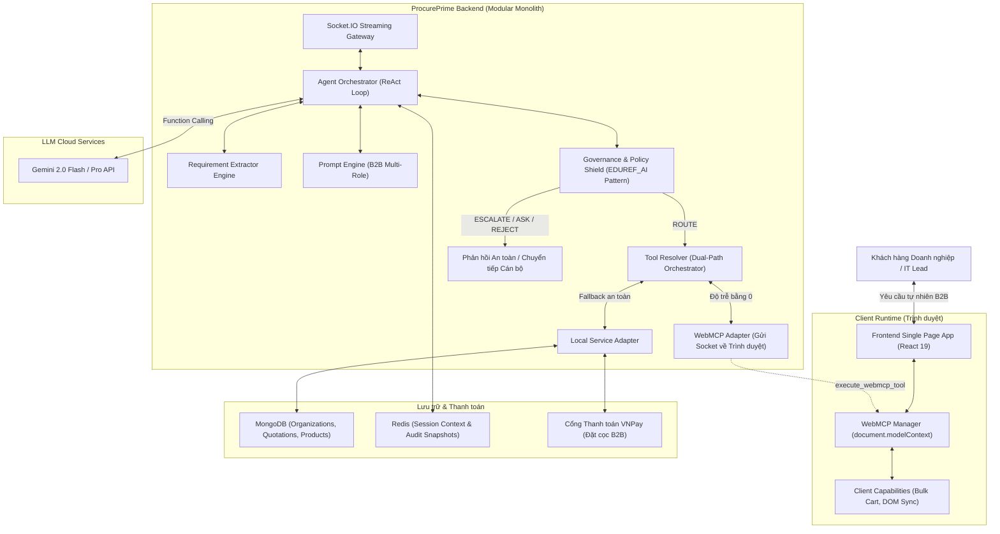

# 🏛️ PHASE 0: DISCOVERY, CODEBASE AUDIT & ARCHITECTURAL FOUNDATION
> **Dự án:** **ProcurePrime — Autonomous B2B Procurement & Smart Quotation Agent**  
> **Đội ngũ phát triển:** **AgentX Prime**  
> **Tài liệu kiểm toán:** Báo cáo chính thức phục vụ tái thiết dự án từ đầu (Rebuild from Scratch)  
> **Mã nguồn tham chiếu:**  
> 1. `d:\DA_CNPM` *(Core E-Commerce, WebMCP, Gemini ReAct, VNPay - Read-only)*  
> 2. `D:\MLAI_HACKATHON\equipment_agent\DA_CNPM\EDUREF_AI` *(Policy Engine, Escalation Referee, Audit Protocol - Read-only)*

---

## 📑 MỤC LỤC
1. [EXISTING SYSTEM AUDIT (KIỂM TOÁN HỆ THỐNG GỐC DA_CNPM)](#1-existing-system-audit-kiểm-toán-hệ-thống-gốc-da_cnpm)
2. [REUSABLE COMPONENT INVENTORY (DANH MỤC TÀI NGUYÊN TÁI SỬ DỤNG)](#2-reusable-component-inventory-danh-mục-tài-nguyên-tái-sử-dụng)
3. [TECHNICAL DEBT & SECURITY RISKS (BÁO CÁO NỢ KỸ THUẬT & RỦI RO)](#3-technical-debt--security-risks-báo-cáo-nợ-kỹ-thuật--rủi-ro)
4. [TÁI CẤU TRÚC POLICY ENGINE TỪ EDUREF_AI SANG PROCUREPRIME](#4-tái-cấu-trúc-policy-engine-từ-eduref_ai-sang-procureprime)
5. [KIẾN TRÚC ĐỀ XUẤT PROCUREPRIME (PROPOSED ARCHITECTURE)](#5-kiến-trúc-đề-xuất-procureprime-proposed-architecture)
6. [CẤU TRÚC THƯ MỤC MỚI (PROPOSED FOLDER STRUCTURE)](#6-cấu-trúc-thư-mục-mới-proposed-folder-structure)
7. [KẾ HOẠCH TRIỂN KHAI CHI TIẾT 7 GIAI ĐOẠN (REBUILD PLAN)](#7-kế-hoạch-triển-khai-chi-tiết-7-giai-đoạn-rebuild-plan)

---

## 1. EXISTING SYSTEM AUDIT (KIỂM TOÁN HỆ THỐNG GỐC DA_CNPM)

### 1.1. Bản chất hệ thống cũ
Dự án tham chiếu `d:\DA_CNPM` là một website Thương mại điện tử Bán lẻ (B2C Retail Monorepo):
* **Backend:** Node.js/Express (ES Modules), MongoDB (Mongoose ORM), Redis (lưu trữ session chat), Socket.IO (streaming AI Agent chunks), Gemini API (`@google/genai`).
* **Frontend:** React 19, TypeScript, Vite, TailwindCSS, Socket.IO Client, WebMCP Runtime tự xây dựng (`WebMCPManager.ts`).
* **Khoảng cách nghiệp vụ (Business Gap):**
  - Hệ thống hoàn toàn thiết kế cho khách hàng cá nhân mua 1-2 món hàng.
  - Không có thực thể Pháp nhân Doanh nghiệp (`Organization`), không có Phân quyền phòng ban (`Department`), không có Quy trình thu mua dự án (`ProcurementRequest`), không có Động cơ Báo giá thương mại (`Quotation`), không có Quy chế duyệt chi (`Approval Workflow`).
* **AI Agent hiện tại:**
  - Triển khai ReAct loop với Tool-calling nhưng dựa trên intent routing bằng từ khóa tĩnh (`IntentRouter.js`).
  - Các công cụ thao tác trên giỏ hàng đơn lẻ, chưa hỗ trợ xử lý gói dự toán B2B số lượng lớn.

---

## 2. REUSABLE COMPONENT INVENTORY (DANH MỤC TÀI NGUYÊN TÁI SỬ DỤNG)

| STT | Thành phần tái sử dụng | Nguồn tham chiếu | Giá trị kỹ thuật kế thừa |
| :---: | :--- | :--- | :--- |
| **1** | **Gemini Streaming & Tool-calling Protocol** | `d:\DA_CNPM\backend\modules\ai-agent\llm\GeminiStreamClient.js` | Cơ chế streaming chữ thời gian thực song song với phát hiện function call của Gemini SDK. |
| **2** | **WebMCP Dual-Path Orchestration** | `d:\DA_CNPM\backend\modules\ai-agent\tools\adapters\` & `frontend\src\webmcp\` | Mô hình ủy quyền thực thi công cụ xuống Client Runtime của trình duyệt qua WebSocket (Zero-latency UI Sync), fallback an toàn về Server. |
| **3** | **Cấu trúc Dữ liệu Thông số Kỹ thuật** | `d:\DA_CNPM\backend\models\SpecificationModel.js` | Mô hình lưu cặp Key-Value thông số phần cứng (RAM, CPU, SSD, Bảo hành) phục vụ bộ lọc cấu hình B2B. |
| **4** | **Cổng thanh toán VNPay SDK** | `d:\DA_CNPM\backend\services\VnPayService.js` | Thuật toán băm SHA512 tạo URL thanh toán và xác thực IPN response dùng làm kênh đặt cọc đơn thu mua. |
| **5** | **Redis Session & History Memory** | `d:\DA_CNPM\backend\services\redisChatService.js` | Cơ chế lưu trữ lịch sử hội thoại ReAct đa bước và quản lý TTL session. |
| **6** | **UI Atoms & Icons** | `d:\DA_CNPM\frontend\src\components\` | Bộ components giao diện (Modal, Button, Table, Toast notification, Lucide icons). |
| **7** | **Policy Engine & Escalation Referee** | `D:\MLAI_HACKATHON\equipment_agent\DA_CNPM\EDUREF_AI\` | Bộ thẩm định quy chế 4 quyết định (`DECISIONS`), 5 phân loại bất định (`CLASSIFICATIONS`), cơ chế snapshot SHA256 và câu hỏi chuyển tiếp (`actionableQuestion`). |

---

## 3. TECHNICAL DEBT & SECURITY RISKS (BÁO CÁO NỢ KỸ THUẬT & RỦI RO)

1. **Thiếu tầng Chốt chặn Chính sách (Governance Shield):**
   - *Rủi ro:* Trong `DA_CNPM`, AI Agent tự quyết định hành động thông qua prompt string. Không có cơ chế chặn đứng hành vi đặt hàng khi vượt ngân sách hoặc sai thẩm quyền.
   - *Khắc phục:* Đưa vào Policy Engine kế thừa từ `EDUREF_AI`.
2. **Khuôn mẫu dữ liệu B2C cứng nhắc:**
   - Các bảng `Cart`, `Order` không có trường Mã số thuế, Chiết khấu số lượng lớn (Volume Discount), Báo giá tạm thời (Proforma Quotation).
3. **Intent Router bằng từ khóa regex (`IntentRouter.js`):**
   - Dễ bị dương tính giả (false positive), không phân tích được các câu lệnh nghiệp vụ đa biến (vừa cấu hình, vừa số lượng, vừa trần ngân sách).
4. **Trộn lẫn UI & WebSocket trong 1 file khổng lồ:**
   - File `AIAgentChat.tsx` (>760 dòng) cần được bóc tách thành các module chuyên biệt: `useAIAgentSocket`, `useWebMCP`, `AgentMessageList`, `QuotationPreviewModal`.

---

## 4. TÁI CẤU TRÚC POLICY ENGINE TỪ EDUREF_AI SANG PROCUREPRIME

Dự án kế thừa trực tiếp cấu trúc của [`StudentConfirmationDecisionService.js`](file:///D:/MLAI_HACKATHON/equipment_agent/DA_CNPM/EDUREF_AI/backend/services/StudentConfirmationDecisionService.js) và [`EscalationThreshold.js`](file:///D:/MLAI_HACKATHON/equipment_agent/DA_CNPM/EDUREF_AI/backend/services/EscalationThreshold.js) thuộc `EDUREF_AI`, chuyển đổi từ bài toán **Thẩm định Học vụ** sang **Thẩm định Thu mua Doanh nghiệp (B2B Procurement)**:

```
                                  [YÊU CẦU THU MUA TỰ NHIÊN]
                                              │
                                              ▼
                             [AI AGENT: PHÂN TÍCH & ĐỀ XUẤT GÓI]
                                              │
                                              ▼
                             ═══════════════════════════════════
                              PROCUREMENT POLICY ENGINE SHIELD
                             ═══════════════════════════════════
                                              │
                ┌──────────────────┬──────────┴──────────┬──────────────────┐
                ▼                  ▼                     ▼                  ▼
        [1. AUTO_APPROVED]  [2. ASK_CLARIFICATION] [3. REJECTED_POLICY] [4. ESCALATE_STAFF]
        • Ngân sách <= 50tr  • Thiếu RAM/CPU/Số    • Vượt trần tuyệt    • 50tr - 200tr:
        • Đủ cấu hình        lượng                 đối (> Ngân sách cấp)   Trưởng phòng duyệt
        • Danh mục chuẩn    • Người dùng chỉ hỏi  • Tài khoản bị khóa   • > 200tr: CFO duyệt
                │            thông tin             • Hàng cấm/ngừng sx  • Chiết khấu vượt khung
                ▼                  │                     │                  │
        [THỰC THI WEBMCP]          ▼                     ▼                  ▼
        Gom giỏ hàng tức    [DỪNG LẠI HỎI RÕ]     [TỪ CHỐI TƯỜNG MINH]  [ĐÓNG GÓI HỒ SƠ]
        thì & Xuất báo giá                                              Kèm actionableQuestion
```

### Chi tiết 4 Quyết định chuẩn tắc (DECISIONS):
1. **`AUTO_APPROVED` (`ROUTE`):** Thỏa mãn đầy đủ các điều kiện thường quy $\rightarrow$ AI được phép gọi `bulk_add_to_cart` và lập Báo giá tự động 100%.
2. **`ASK_CLARIFICATION` (`ASK`):** Thiếu thông số thiết yếu (chưa rõ số lượng máy tính, chưa rõ mức RAM cần thiết, hoặc người dùng chỉ đang hỏi giá tham khảo) $\rightarrow$ AI dừng lại, đặt câu hỏi làm rõ.
3. **`REJECTED_POLICY` (`REJECT`):** Vi phạm chính sách cứng (yêu cầu thiết bị ngoài danh mục cho phép của công ty, ngân sách trần âm, tài khoản không có quyền thu mua) $\rightarrow$ Từ chối dứt khoát kèm lý do điều khoản.
4. **`ESCALATE_TO_STAFF` (`ESCALATE`):** Vượt quá thẩm quyền tự động hóa của AI:
   - Đơn hàng từ $50.000.000$ đến $200.000.000$ VNĐ: Chuyển tiếp Trưởng phòng Mua hàng (`targetRole: 'PROCUREMENT_MANAGER'`).
   - Đơn hàng $> 200.000.000$ VNĐ: Chuyển tiếp Giám đốc Tài chính (`targetRole: 'CFO'`).
   - Yêu cầu chiết khấu sỉ vượt khung chính sách ($> 10\%$).
   - Kèm theo `actionableQuestion` chuẩn để cấp trên duyệt trong 1 click:  
     *“Giám đốc/CFO có chấp thuận cấp bổ sung 5.000.000 VNĐ để phê duyệt gói 10 laptop chuyên dụng cho phòng R&D không?”*

---

## 5. KIẾN TRÚC ĐỀ XUẤT PROCUREPRIME (PROPOSED ARCHITECTURE)

Áp dụng mô hình **Modular Monolith** chuẩn doanh nghiệp:



---

## 6. CẤU TRÚC THƯ MỤC MỚI (PROPOSED FOLDER STRUCTURE)

```text
d:\LIKELION-HACKATHON\ProcurePrime\
├── backend/
│   ├── src/
│   │   ├── config/                  # Môi trường, MongoDB, Redis, Gemini, VNPay
│   │   ├── modules/
│   │   │   ├── auth/                # JWT, Đăng nhập Doanh nghiệp, Phân quyền RBAC
│   │   │   ├── organizations/       # Hồ sơ công ty, Phòng ban, Hạn mức ngân sách
│   │   │   ├── catalog/             # Sản phẩm, Danh mục, Thông số kỹ thuật
│   │   │   ├── procurement/         # Yêu cầu thu mua, So khớp cấu hình
│   │   │   ├── cart/                # Giỏ hàng thu mua B2B số lượng lớn
│   │   │   ├── quotation/           # Động cơ Báo giá, Chiết khấu sỉ, Thuế VAT 10%
│   │   │   ├── approval/            # Quy trình duyệt chi, Hồ sơ chuyển tiếp
│   │   │   ├── governance/          # Policy Engine (Kế thừa từ EDUREF_AI)
│   │   │   │   ├── ProcurementPolicyEngine.js
│   │   │   │   ├── PolicyThresholds.js
│   │   │   │   ├── PolicyContracts.js
│   │   │   │   └── AuditTrailService.js
│   │   │   └── ai-agent/            # Tác tử AI Tự hành ReAct
│   │   │       ├── orchestrator/    # Vòng lặp ReAct Planning
│   │   │       ├── extractor/       # Bóc tách cấu hình, số lượng, ngân sách trần
│   │   │       ├── prompts/         # Prompt templates phân tầng
│   │   │       ├── tools/           # 16 Tool definitions & Zod validation
│   │   │       └── adapters/        # WebMCP Adapter & LocalService Adapter
│   │   ├── shared/                  # Middleware, Centralized Error Handling, Logger
│   │   └── server.js                # Entry point
│   └── package.json
│
├── frontend/
│   ├── src/
│   │   ├── api/                     # Quản lý API tập trung (Axios)
│   │   ├── components/              # UI Atoms tái sử dụng (Button, Modal, Table)
│   │   ├── features/                # Phân rã theo nghiệp vụ B2B
│   │   │   ├── procurement-workspace/# Khung làm việc thu mua
│   │   │   ├── quotation-viewer/    # Xem, in & xuất Báo giá Doanh nghiệp
│   │   │   ├── agent-chat/          # Khung chat tác tử AI Streaming
│   │   │   └── approval-center/     # Bảng điều khiển duyệt chi cho Quản lý/CFO
│   │   ├── hooks/                   # Custom hooks: useAIAgent, useWebMCP, useCart
│   │   ├── webmcp/                  # WebMCP Runtime Client
│   │   │   ├── WebMCPManager.ts
│   │   │   └── tools/               # Client Capabilities (bulk_add_to_cart...)
│   │   ├── types/                   # TypeScript Contracts & Interfaces
│   │   └── App.tsx
│   └── package.json
│
└── docs/                            # Bộ tài liệu kiến trúc & thuyết trình
    ├── PHASE_0_AUDIT_AND_ARCHITECTURE.md  # File hiện tại
    ├── HACKATHON_RULE_2026.md             # Thể lệ cuộc thi K-Tech College 2026
    ├── ProcurePrime_Pitch_Deck_Guide.md   # Dàn ý Slide & Kịch bản Pitch 2 phút
    └── governance-and-policies.md         # Đặc tả chi tiết Policy Engine
```

---

## 7. KẾ HOẠCH TRIỂN KHAI CHI TIẾT 7 GIAI ĐOẠN (REBUILD PLAN)

1. **Phase 1 — Project Foundation:** Setup cấu hình chuẩn, scripts khởi động, validation biến môi trường, shared error handling và test framework.
2. **Phase 2 — Core Business Domain:** Xây dựng Domain Models chuẩn B2B (`Organization`, `Product`, `Specification`, `ProcureRequest`, `ProcureCart`, `Quotation`, `ApprovalRequest`).
3. **Phase 3 — AI Agent & Requirement Extractor:** Xây dựng ReAct Orchestrator, Prompt Engine đa tầng B2B, bộ bóc tách thông số kỹ thuật và 16 Tools kèm Zod Schema.
4. **Phase 4 — Governance & Execution Shield:** Hiện thực hóa Policy Engine theo mẫu EDUREF_AI, tích hợp WebMCP Adapter với cơ chế Idempotency Key chống gọi trùng.
5. **Phase 5 — Quotation Engine & Pricing Rules:** Xây dựng bộ tính chiết khấu khối lượng (B2B Volume Discount), thuế VAT 10%, và xuất bản Báo giá Doanh nghiệp.
6. **Phase 6 — Frontend Procurement Workspace:** Tái cấu trúc giao diện Frontend theo Feature-driven, tích hợp WebMCP thời gian thực và modal Báo giá trực quan.
7. **Phase 7 — Verification, Testing & Final Documentation:** Viết bộ E2E Test tự động hóa và hoàn thiện bộ tài liệu kỹ thuật của dự án.

